  

 

  <strong>Information Systems graduate turning complex data into clear decisions.</strong> 
  I work across data cleaning, exploratory analysis, dashboarding, and predictive modeling 
  using Python, SQL, Power BI, Looker Studio, and machine learning.

  🎯 Open to entry-level <strong>Data Analyst, BI, and Data Science</strong> roles

  
  
  
  

 

<h2 align="center">🛰️ Data Constellation</h2>

  
<strong>Languages &amp; Querying</strong>

  

  
<strong>Analytics, Machine Learning &amp; Deployment</strong>

  
  
  
  
  

  
<strong>Business Intelligence &amp; Design</strong>

  
  
  

 

<h2 align="center">🐍 Event Horizon Contribution Trail</h2>

The snake follows every contribution through the gravity well only the strongest signals make it grow.

<picture>
  <source media="(prefers-color-scheme: dark)" srcset="https://raw.githubusercontent.com/alkakoswara/alkakoswara/snake-output/snake-contribution-graph-dark.svg">
  <source media="(prefers-color-scheme: light)" srcset="https://raw.githubusercontent.com/alkakoswara/alkakoswara/snake-output/snake-contribution-graph.svg">
  
</picture>

 

<h2 align="center">📡 Establish Contact</h2>

  Interested in analytics, business intelligence, or data science opportunities? 
  Let's turn raw information into decisions that matter.

  
  &nbsp;&nbsp;
  

 

<em>From raw signals to meaningful insight—one orbit at a time.</em>

