  

 

  <strong>Information Systems graduate turning complex data into clear decisions.</strong> 
  I work across SQL analysis, dashboarding, and predictive modeling, 
  and I am building toward a Data Scientist role.

  🎯 Open to internships and entry-level <strong>Data Analyst, BI, and Data Science</strong> roles

  
  
  

 

## 🛰️ Skills

Tools I use or explore. Click a logo to open its website or documentation.

  

<table align="center">
<tr>
<td width="50%" valign="top">
  <strong>Languages</strong> 

  
  
  
</td>
<td width="50%" valign="top">
  <strong>Databases</strong> 

  
</td>
</tr>
<tr>
<td width="50%" valign="top">
  <strong>Data science & notebooks</strong> 

  
</td>
<td width="50%" valign="top">
  <strong>Business intelligence</strong> 

  
  
</td>
</tr>
<tr>
<td colspan="2" valign="top">
  <strong>Development & design</strong> 

  
  
  
  
</td>
</tr>
</table>

 

<h2 align="center">🐍 Event Horizon Contribution Trail</h2>

<picture>
  <source media="(prefers-color-scheme: dark)" srcset="https://raw.githubusercontent.com/alkakoswara/alkakoswara/snake-output/snake-contribution-graph-dark.svg">
  <source media="(prefers-color-scheme: light)" srcset="https://raw.githubusercontent.com/alkakoswara/alkakoswara/snake-output/snake-contribution-graph.svg">
  
</picture>

 

<h2 align="center">📡 Get in Touch</h2>

  Interested in analytics, business intelligence, or data science opportunities? 
  I would be glad to talk.

  
  &nbsp;&nbsp;
  

