  

  
  
  

 

  <strong>Information Systems graduate turning complex data into clear decisions.</strong> 
  I work across data cleaning, exploratory analysis, dashboarding, and predictive modeling 
  using Python, SQL, Power BI, Looker Studio, and machine learning.

  📍 Bogor, Indonesia &nbsp;·&nbsp; 🎯 Open to entry-level <strong>Data Analyst, BI, and Data Science</strong> roles

  
  
  
  

 

<h2 align="center">🛰️ Data Constellation</h2>

  
<strong>Languages &amp; Querying</strong>

  

  
<strong>Analytics, Machine Learning &amp; Deployment</strong>

  
  
  
  
  

  
<strong>Business Intelligence &amp; Design</strong>

  
  
  

 

<h2 align="center">🌌 Featured Missions</h2>

### 🦠 SIDINI — Outbreak Early Warning Dashboard

**1st Place of 9 teams · Digital Pulse, Digital Health Innovation** · October 2026 
[Open live demo](https://sidini-surveilans.narasi-nusantara.workers.dev)

- Designed outbreak-signal logic using ratio-to-baseline, incidence thresholds, and a minimum-case rule to reduce alert fatigue.
- Modeled 23 villages, 4 diseases, a 28-day trend, reporting delays, and weekly SKDR district summaries using simulated data.
- Added LLM-generated explanations and recommended actions for both technical and non-technical users.

### 🚗 Used Car Price Prediction — ML Web App

**Undergraduate thesis · CRISP-DM** · April–August 2026 
[Explore the repository](https://github.com/alkakoswara/used-car-price-prediction-ml)

- Scraped 1,667 raw listings and produced a clean dataset of 1,118 records after removing 544 pseudo-duplicates.
- Tuned Random Forest, LightGBM, and CatBoost with GridSearchCV and 5-fold cross-validation.
- Best result: **R² 0.9303 · MAE Rp11.27M · RMSE Rp19.63M**, deployed through Gradio with LLM-powered explanations.

### 🛒 Olist Customer Behavior Analysis

**PostgreSQL &amp; Power BI portfolio project** · October–November 2026 
[Explore the repository](https://github.com/alkakoswara/olist-customer-behavior-analysis)

- Analyzed repeat purchase behavior across **93,358 customers** with delivered orders.
- Identified a **3.0% repeat purchase share** and segmented customers using RFM analysis.
- Built an interactive dashboard and proposed a campaign test targeting 1,094 historically identified customers.

  
<strong>🎨 UI/UX Research — Cafe Panas Tearik Mobile App</strong>

   
  Conducted research with 72 customers and 2 staff members, identified 5 key usability issues, and tested 7 user journeys with 26 participants in Maze—achieving a 98% usability score.

 

<h2 align="center">🔭 Experience &amp; Education</h2>

### Junior Data Scientist · PT Vinix Seven Aurum

**Independent Study, Batch 3 · Team of 5** · September–December 2025

- Cleaned, transformed, and prepared data; performed EDA to surface trends and business insights.
- Supported feature engineering, model validation, and relational data extraction with SQL.
- Built interactive visualizations using Looker Studio, Power BI, Matplotlib, and Seaborn.

### Information Systems · Gunadarma University

**GPA 3.60/4.00** · September 2022–August 2026

Thesis: *Comparative Analysis of Random Forest, LightGBM, and CatBoost Models for Used Car Price Prediction.*

  
<strong>📡 Certifications &amp; community signal</strong>

   

  - Data Analyst — Certificate of Competence, LSP Universitas Gunadarma on behalf of BNSP (valid for 3 years)
  - Alibaba Cloud Certified Associate — Alibaba Cloud × Digital Talent Scholarship
  - Creating Business Intelligence — Gunadarma
  - Data Preparation for Business Processes — Gunadarma
  - PIC Backstage Talent Volunteer — Bogor Nation Matsuri 2024; coordinated a two-day event and five cross-functional teams

 

<h2 align="center">🐍 Event Horizon Contribution Trail</h2>

The snake follows every contribution through the gravity well—only the strongest signals make it grow.

<picture>
  <source media="(prefers-color-scheme: dark)" srcset="https://raw.githubusercontent.com/alkakoswara/alkakoswara/snake-output/snake-contribution-graph-dark.svg">
  <source media="(prefers-color-scheme: light)" srcset="https://raw.githubusercontent.com/alkakoswara/alkakoswara/snake-output/snake-contribution-graph.svg">
  
</picture>

 

<h2 align="center">📡 Establish Contact</h2>

  Interested in analytics, business intelligence, or data science opportunities? 
  Let's turn raw information into decisions that matter.

  
  

 

<em>From raw signals to meaningful insight—one orbit at a time.</em>

